# Typeahead DevOps Capstone

[](https://github.com/vimalyad/typeahead-devops-capstone/actions/workflows/ci.yml)

**A search-suggestion app shipped through a complete DevOps pipeline:** tested and security-scanned in GitHub Actions, published to GHCR as SHA-tagged images, deployed to Kubernetes with Helm, watched by Prometheus and Grafana, kept in sync by Argo CD, and described in Terraform for AWS EKS.

Session 21 final project · Vimal Kumar Yadav · 24BCS10273

**[▶ 90-second walkthrough](demo/browser-walkthrough.mp4)** · **[Slides (PPTX)](demo/Typeahead-DevOps-Capstone.pptx)** · **[Slides (PDF)](demo/Typeahead-DevOps-Capstone.pdf)**

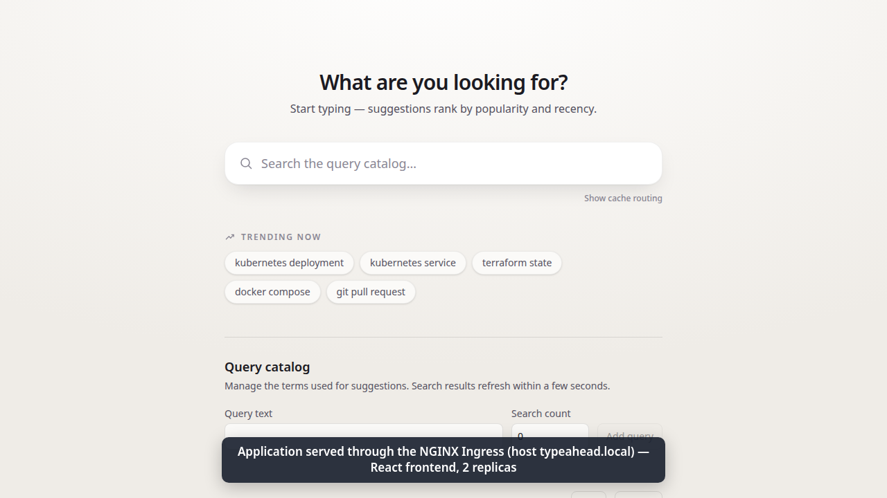

## Highlights

- **Real application, not a template.** Two Spring Boot services, a React frontend, PostgreSQL, Kafka and Redis, adapted from my own [Typeahead](https://github.com/vimalyad/typeahead) project ([SOURCE.md](SOURCE.md)).
- **Gated pipeline.** Tests → Semgrep, dependency and secret scans → three non-root images with a Trivy HIGH/CRITICAL gate → GHCR → Helm install on a temporary kind cluster.
- **The gates caught real problems.** Four separate vulnerability findings, from a critical Spring MVC CVE to a libtiff CVE in the Nginx base, were fixed at the source, not suppressed.
- **Kubernetes done properly.** Two replicas per service, three kinds of probes, HPA, Ingress, persistent PostgreSQL and Kafka, read-only non-root containers.
- **GitOps.** Argo CD deploys whatever SHA `gitops/values.yaml` names and reverted a hand edit in 2.09 seconds.
- **Four injected faults**, each diagnosed, fixed and verified.

## Project overview

Typeahead is a searchable query catalog. As you type, the suggestion service returns ranked prefix matches from an in-memory trie, cached in Redis. The catalog supports create, edit and delete. Each search is published to Kafka, the ingestion service raises that query's count in PostgreSQL, and suggestions refresh within seconds.

The course reference uses FastAPI, pytest and Alembic. This project uses the approved Java equivalents: Spring Boot, JUnit/MockMvc and Flyway.

## Architecture

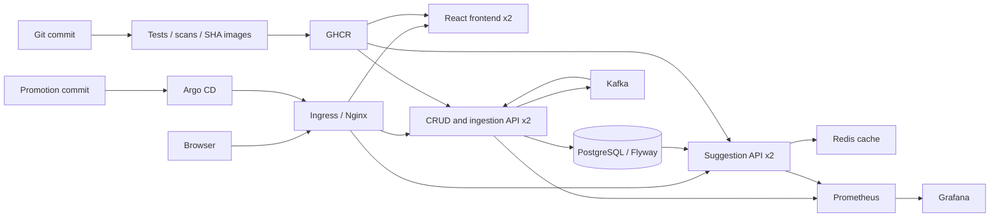

The Ingress sends `/` to the frontend, `/api/queries` and `/api/search` to the ingestion service, and `/api/suggest` to the suggestion service.

## Technologies used

| Area | Tools |
|---|---|
| Application | Java 21, Spring Boot 4.1, React + TypeScript (Vite), PostgreSQL 16, Flyway, Kafka 4.1, Redis 7 |
| Testing | JUnit 5, MockMvc, HTTP smoke test against the real stack, Playwright browser checks |
| Containers | Multi-stage Dockerfiles, Temurin 21 Alpine JRE, Nginx, Docker Compose |
| CI/CD | GitHub Actions, GitHub Container Registry |
| DevSecOps | Semgrep (SAST), Trivy (dependencies and images), Gitleaks (Git history) |
| Kubernetes | Helm, NGINX Ingress, HPA, metrics-server, kind (CI), Minikube (local) |
| Monitoring | Prometheus, Grafana, alert rules |
| GitOps | Argo CD |
| Infrastructure | Terraform, AWS VPC, EKS, EBS CSI with Pod Identity |

## Repository layout

```text
application/        Spring Boot services, React frontend, Flyway migrations
docker/             Backend and frontend Dockerfiles, Nginx config
kubernetes/         Namespace, Secret example, EKS StorageClass
helm/               Application chart (values.yaml local, values-eks.yaml cloud)
terraform/          AWS VPC, EKS cluster, worker node group, storage
.github/workflows/  The CI/CD pipeline
security/           Scanner requirements
monitoring/         Prometheus + Grafana chart and dashboard
gitops/             Argo CD AppProject/Application and the promoted image tag
scripts/            Bootstrap, CI deploy, monitoring, Argo CD install, smoke test
evidence/           Raw command output, CI reports and recordings
screenshots/        Terminal and browser screenshots
demo/               Walkthrough video and presentation deck
```

## Application setup

| Method | Route | Behaviour |
|---|---|---|
| GET | `/api/queries` | List up to 100 catalog entries |
| GET | `/api/queries/{id}` | Read an entry; 404 when absent |
| POST | `/api/queries` | Create a query; 201 with Location |
| PUT | `/api/queries/{id}` | Update text and search count |
| DELETE | `/api/queries/{id}` | Delete an entry; 204 |
| POST | `/api/search` | Publish a normalized search event |
| GET | `/api/suggest?q=...` | Read ranked prefix suggestions |

Create/update JSON is `{"query":"kubernetes deployment","allTimeCount":4}`. Blank or oversized text and invalid counts return 400; duplicate text returns 409. SQL uses prepared parameters. The schema migrations are in `application/db/migration/` and run from the ingestion service.

```bash
cd application
./gradlew --no-daemon test
cd frontend
npm ci
npm run build
```

There are 15 tests: 12 controller cases with mocked database and Kafka collaborators, two hash-ring tests, and one concurrency test. `scripts/smoke.py` separately checks the real PostgreSQL, Kafka and trie path over HTTP and removes its generated data.

## Docker setup

### Docker Compose

Prerequisites: Docker with Compose, Python 3, and a free local port 3000. Generate a temporary password in the shell; do not put it in Git.

```bash
export DATABASE_PASSWORD="$(python3 -c 'import secrets; print(secrets.token_urlsafe(32))')"
docker compose up --build -d
docker compose ps
python3 scripts/smoke.py --url http://127.0.0.1:3000
```

Open `http://localhost:3000`. Backends are available only on loopback ports 18782 and 18781 for `/health`, `/health/readiness`, `/info` and `/metrics`. Kafka and PostgreSQL use named volumes; keep the same password when restarting an existing PostgreSQL volume.

```bash
docker compose logs --tail=60 ingestion-service suggestion-service
docker compose down --volumes --remove-orphans
unset DATABASE_PASSWORD
```

Images are built from source in separate build stages. Runtime users are 65532 for Java and 101 for Nginx; application containers have read-only roots, dropped capabilities and temporary `/tmp` mounts.

### Individual containers

[`run-containers.sh`](run-containers.sh) starts PostgreSQL, Redis, Kafka, both Java services and the frontend with plain `docker run` commands, using the published release images. Passwords go into a private temporary environment file, and ports bind only to loopback.

```bash
bash run-containers.sh up
bash run-containers.sh check
# Open http://localhost:13081 while the lab is running.
bash run-containers.sh down
```

The recorded run passed the browser CRUD and mobile checks, both backends' health and readiness endpoints, and the PostgreSQL/Kafka/search smoke test. All six containers, the network and both volumes were removed afterwards.

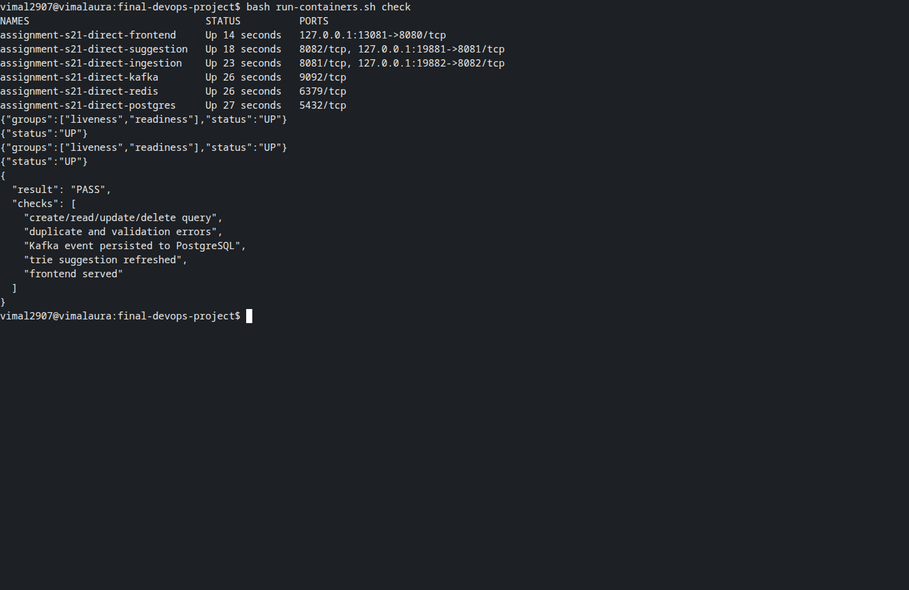

## Kubernetes deployment

Use a dedicated cluster context with an NGINX ingress controller and metrics-server. Bootstrap creates the namespace and a random database Secret if one does not exist yet.

```bash
bash scripts/bootstrap.sh
kubectl -n assignment-s21 get secret typeahead-database
```

The chart deploys:

- two replicas each of the frontend, ingestion and suggestion services, behind ClusterIP Services;
- startup, readiness and liveness probes on both backends, and CPU autoscaling from two to three replicas;
- a ConfigMap for settings and an externally created Secret for the database password;
- an Ingress routing `/`, `/api/queries`, `/api/search` and `/api/suggest`;
- PostgreSQL and Kafka as StatefulSets with persistent volumes; Redis is a rebuildable cache.

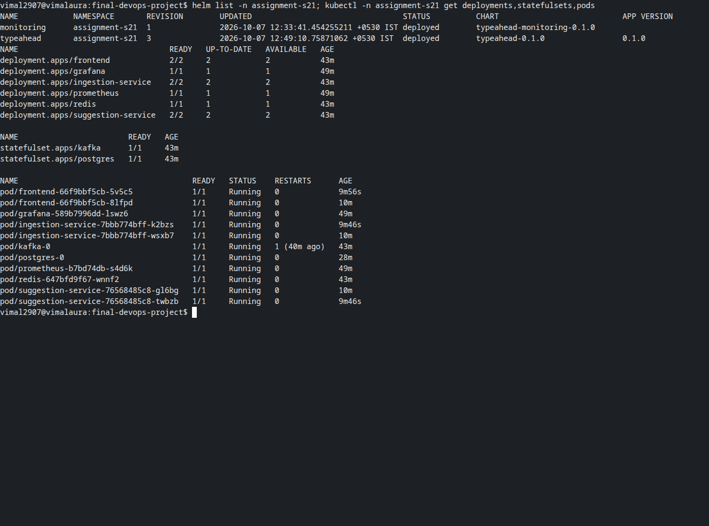

## Helm deployment

```bash
helm upgrade --install typeahead helm -n assignment-s21 \
  --set imageTag=FULL_SUCCESSFUL_COMMIT_SHA,version=FULL_SUCCESSFUL_COMMIT_SHA \
  --wait --timeout 10m
kubectl -n assignment-s21 get pods,svc,ingress,hpa,pvc
helm list -n assignment-s21
```

Use published images, or load the three matching images into the local cluster first. A private registry needs an externally created pull Secret named in `imagePullSecrets`; credentials are never chart values. For EKS, apply `kubernetes/storageclass-eks.yaml` and add `-f helm/values-eks.yaml`.

For local access, forward the ingress controller and send the `Host: typeahead.local` header:

```bash
kubectl -n ingress-nginx port-forward svc/ingress-nginx-controller 18080:80
python3 scripts/smoke.py --url http://127.0.0.1:18080 --host typeahead.local
```

## Terraform infrastructure

The Terraform configuration defines a VPC with two public subnets, one EKS 1.36 cluster with one managed worker, and encrypted gp3 storage through the EBS CSI driver with Pod Identity. There is no NAT gateway or load balancer, to keep a short demo cheap. The Kubernetes API accepts only the operator's IPv4 `/32`.

```bash
cd terraform
cp terraform.tfvars.example terraform.auto.tfvars
# Set the operator's current public IPv4 /32 in that ignored file.
terraform init
terraform fmt -check
terraform validate
terraform plan -out=lab.tfplan
terraform apply lab.tfplan
aws eks update-kubeconfig --region us-east-1 --name vimal-typeahead-capstone
```

A cloud run is meant to be short: collect evidence, delete the Argo CD application, uninstall the charts, remove the PVCs, wait for the EBS volumes to go, then `terraform destroy`.

**Status:** `init`, `validate` and a plan of 21 resources pass. The apply and destroy were not run because no AWS account was available, so the platform was demonstrated on local Kubernetes instead.

## CI/CD pipeline

[`.github/workflows/ci.yml`](.github/workflows/ci.yml) runs on pushes to `main`, on pull requests and on demand.

| Stage | What it does |
|---|---|
| `test` | Runs the 15 Java tests and builds the frontend |
| `security` | Semgrep SAST, Trivy dependency gate, Gitleaks over the Git history |
| `images` | Builds three non-root images, rejects any HIGH/CRITICAL finding, then pushes and re-pulls them by full commit SHA |
| `deploy` | Loads the images into a temporary kind cluster, installs the Helm chart with two replicas per service, runs the smoke test, deletes the cluster even after a failure |

A failed stage stops every stage after it, so an image that fails a scan is never published. CI needs no AWS credentials. Ingress and HPA are exercised on Minikube, because the CI cluster deliberately has no ingress controller or metrics server.

**Latest green release:** [run 38800719007](https://github.com/vimalyad/typeahead-devops-capstone/actions/runs/38800719007), commit `bea59b9`, with all four stages passing. Its images are public at `ghcr.io/vimalyad/typeahead-devops-capstone-{ingestion,suggestion,frontend}:bea59b98495c4d4d7dc573be9900f7ec3afe4684`, and that SHA is what `gitops/values.yaml` promotes.

The first two runs in this repository were stopped by the gates, as intended: [run 38798816287](https://github.com/vimalyad/typeahead-devops-capstone/actions/runs/38798816287) at the dependency gate and [run 38799769946](https://github.com/vimalyad/typeahead-devops-capstone/actions/runs/38799769946) at the image gate. Both fixes are described under DevSecOps below. Earlier green releases from when the project lived in the course repository are [run 37586435056](https://github.com/vimalyad/devops-heros/actions/runs/37586435056) and [run 37588149332](https://github.com/vimalyad/devops-heros/actions/runs/37588149332).

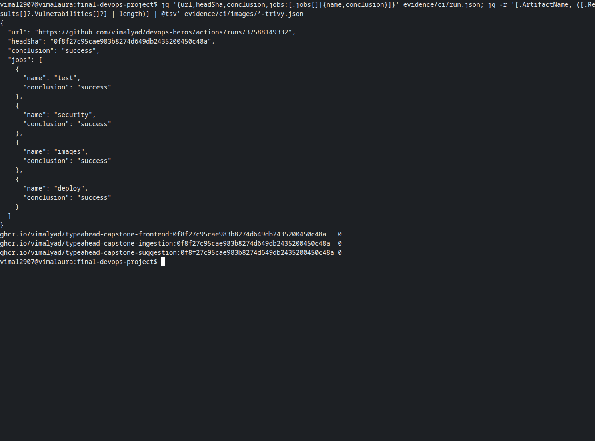

## DevSecOps implementation

| Check | Tool | Gate |
|---|---|---|
| SAST | Semgrep `p/java`, `p/typescript` | Fails on findings |
| Dependencies (SCA) | Trivy filesystem scan, including dev dependencies | Fails on HIGH/CRITICAL |
| Secrets | Gitleaks over the full Git history | Fails on any leak |
| Container images | Trivy on all three runtime images | Fails on HIGH/CRITICAL, before publishing |

What the gates caught:

- **CVE-2026-47884 (critical) in Spring MVC.** Spring 6 had no fixed release, so the services moved to Spring Boot 4.1.1 and Spring 7, then Tomcat 11.0.25 and Jackson 3.1.7.
- **Eight HIGH/CRITICAL findings** in Debian 13 `libexpat` and `libuuid` in the original distroless base, with no fix available. The runtime moved to the Temurin 21 Alpine JRE, keeping UID 65532.
- **CVE-2026-106451 (high) in `lz4-java` 1.10.1**, pulled in by the Kafka client and published after the earlier green releases. A Gradle constraint now resolves the fixed 1.11.4.
- **CVE-2026-4775 (high) in `tiff` 4.7.1** in the frontend's Nginx Alpine base. The digest pin moved to the current build of the same tag, which ships 4.7.2.

Nothing is suppressed and there is no ignore file. [SECURITY.md](SECURITY.md) has the details.

## Monitoring

Prometheus discovers every backend replica through headless metrics Services, so new HPA replicas are scraped automatically. Grafana provisions a read-only dashboard showing request rate, latency, JVM heap and scrape health, and there is an alert rule for a backend going down.

```bash
bash scripts/monitoring.sh
kubectl -n assignment-s21 port-forward svc/grafana 13000:3000
kubectl -n assignment-s21 port-forward svc/prometheus 19090:9090
```

A load run of **120,415 requests from 16 clients in 80 seconds** had zero failures, and the suggestion HPA scaled 2 → 3 → 2.

| Prometheus targets | Grafana dashboard |
|---|---|
| 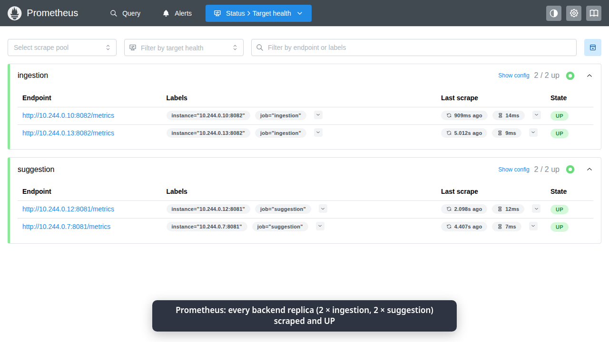 | 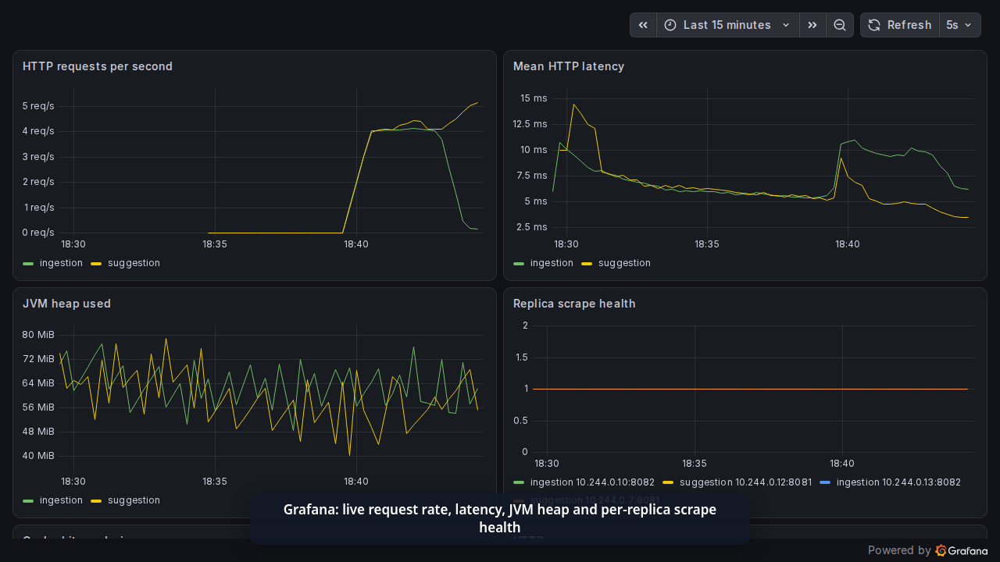 |

## GitOps

1. CI publishes images tagged with the commit SHA.
2. A promotion commit writes that SHA into [`gitops/values.yaml`](gitops/values.yaml).
3. Argo CD syncs it automatically, with prune and self-heal.
4. The application's `/info` endpoint reports the same SHA.

```bash
bash scripts/install-argocd.sh
kubectl apply -f gitops/application.yaml
kubectl -n argocd get applications
```

The AppProject only allows this repository and the `assignment-s21` namespace. In the drift test, a hand-edited frontend Service selector was reverted to the Git version in 2.09 seconds.

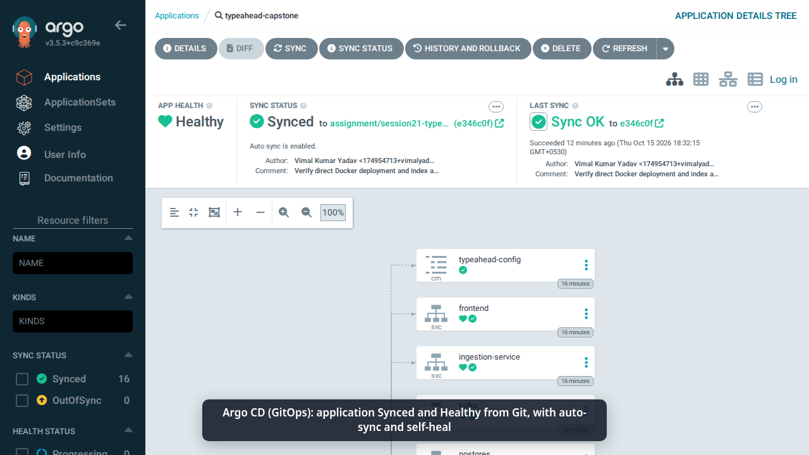

To tear down, remove the Argo CD application before Helm so it cannot recreate what you delete:

```bash
kubectl -n argocd delete application typeahead-capstone
kubectl -n argocd delete appproject typeahead-capstone
helm uninstall typeahead monitoring -n assignment-s21 --wait
kubectl delete namespace assignment-s21 --wait
kubectl get pv
```

## Troubleshooting

| Fault | What I saw | Root cause and fix | Verified |
|---|---|---|---|
| Kafka DNS missing at startup | `No resolvable bootstrap urls` | The consumer thread exited for good; it now retries after a bounded delay | The same container recovered once DNS returned, without a restart |
| Wrong Service selector | Ingress 503, empty EndpointSlice | The selector matched no pods; restored `app=ingestion-service` | The same route returned 200 |
| PostgreSQL pod deleted | StatefulSet created a new pod | Confirmed it mounted the existing PVC | A saved row still read 17 |
| Hand edit drifted from Git | Live selector became `frontend-drift` | Argo CD self-heal applied the Git definition | Restored in 2.09 s |

The first Kubernetes launch also exposed a readiness deadlock: Kafka could not resolve its own controller hostname until it was Ready. `publishNotReadyAddresses: true` breaks that cycle. [FAULTS.md](FAULTS.md) has the full write-up and evidence.

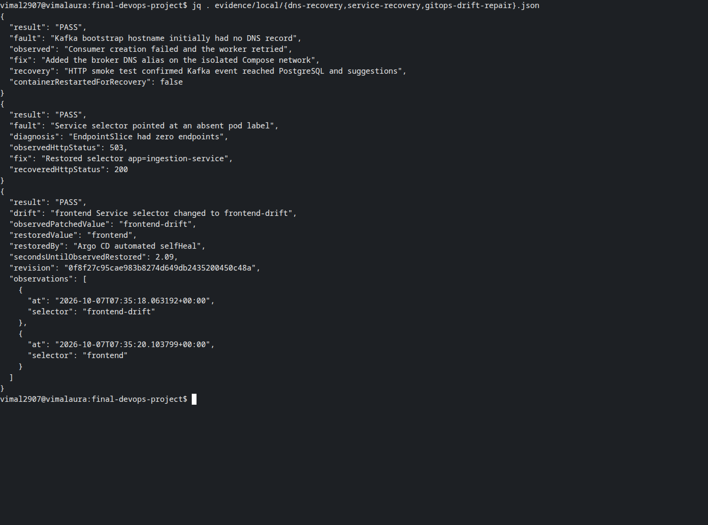

## Screenshots

| | |
|---|---|
| 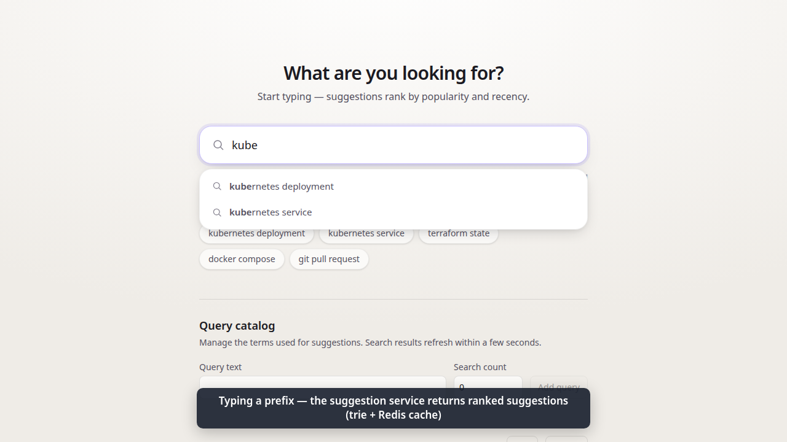 | 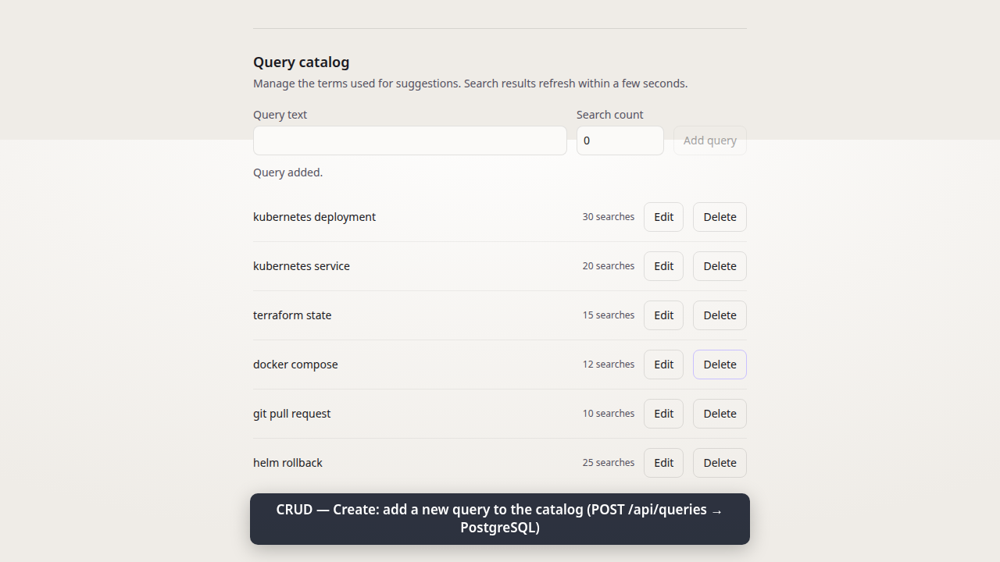 |
| Ranked suggestions while typing | A query created through the catalog form |
| 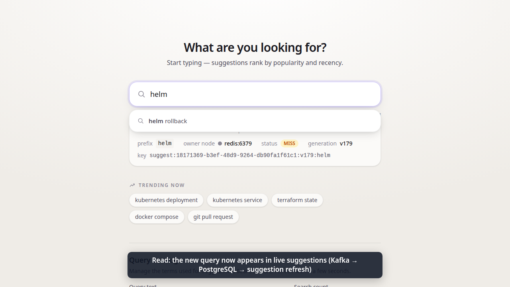 | 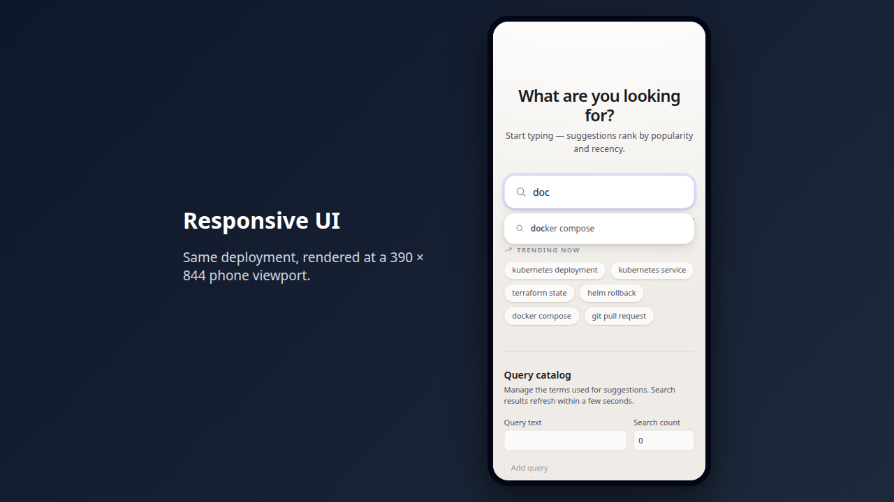 |
| The new query appearing in suggestions | 390 × 844 phone layout |

More terminal evidence is in [`screenshots/`](screenshots/) and described in [evidence/README.md](evidence/README.md).

## Demo

[`demo/`](demo/) has the 90-second browser walkthrough and the presentation deck as PPTX and PDF. [`evidence/commit-to-deployment.cast`](evidence/commit-to-deployment.cast) is a 10.5-minute terminal recording of one release going from commit through CI, GHCR and promotion to Argo CD. [DEMO.md](DEMO.md) explains how to present both.

## Lessons learned

- **Readiness can deadlock.** Kafka could not resolve its own name until it was Ready, and it could not become Ready without that name.
- **Background workers must retry.** A consumer that gave up on one DNS error silently stopped the whole event path.
- **Scans earn their place.** Two releases were blocked, and both were fixed at the source instead of ignored.
- **Tag by SHA, promote by commit.** It is always clear which build is running and how it got there.
- **A clean scan is not proof of safety.** It means no known vulnerability in today's database, nothing more.

## Status and limitations

- Everything except the AWS apply/destroy was run and recorded; the Terraform is validated and planned only.
- The CRUD API has no authentication and must stay on a local or controlled network.
- Kafka and PostgreSQL run one instance each, and event processing is at least once.

See the [requirement map](REQUIREMENTS.md) for how each rubric module is covered. This project was first built inside the course repository ([vimalkryadav/devops-heros](https://github.com/vimalkryadav/devops-heros)); its Git history was carried over here.
